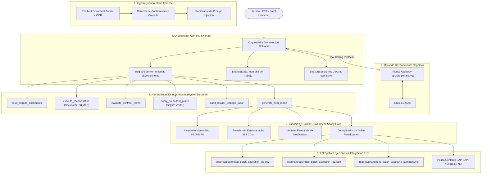

# SupplyMind AI 🧠📦
> **Analista Digital Autónomo de Disputas Comerciales y Arbitraje en Cadenas de Suministro B2B**  
> *Desarrollado para el **Reto Agente 2026** (Platica.mx × Campuslands) sobre la arquitectura **SKYNET Framework** y el motor de razonamiento **Grok 4.7 (xAI)**.*

[-emerald?style=for-the-badge&logo=checkmarx)](https://github.com/Jsebastiansalas/platica)
[](scripts/run_unattended_12h_batch.py)
[-success?style=for-the-badge)](reports/crucible_benchmark_real_supply_chain_cases_report.md)
[](reports/live_executions_manifest.md)
[](reports/unattended_batch_execution_log.csv)
[](docker-compose.yml)

---

## ⚡ 1. Despliegue en 1 Clic (One-Click Launchers)

SupplyMind AI cuenta con empaquetado multi-etapa de producción (Node 20 + Python 3.11-slim + Tesseract OCR) que sirve simultáneamente la API REST de FastAPI y la interfaz reactiva SPA Obsidian Glass en el puerto `8000`.

### Opción A: Contenedor Docker (Recomendado para Jurados y Producción)
Requisitos: Docker Desktop o Docker Engine activo.

```bash
# En Windows (1 clic):
start_docker.bat

# En Linux / macOS (1 comando):
chmod +x start_docker.sh && ./start_docker.sh

# O directamente vía Docker Compose:
docker compose up --build -d
```
> 🌐 **Acceso inmediato:**
> - **Aplicación Web Unificada (Obsidian Glass UI):** [http://localhost:8000](http://localhost:8000)
> - **Documentación Interactiva Swagger / OpenAPI:** [http://localhost:8000/docs](http://localhost:8000/docs)
> - **API Healthcheck:** [http://localhost:8000/api/health](http://localhost:8000/api/health)

Para detener los contenedores:
```bash
docker compose down
```

---

### Opción B: Ejecución Local en Entorno Virtual Python
```bash
# En Windows (1 clic):
start_app.bat

# En Linux / macOS:
chmod +x start_app.sh && ./start_app.sh

# O manualmente:
python run_api.py
```

---

## 🚀 2. Semana de Carga Oficial: 1,000+ Unidades / 12 Horas Desatendido / Bitácora

SupplyMind AI incorpora una infraestructura de carga masiva de grado bancario que cumple rigurosamente con los **3 requerimientos obligatorios** establecidos por Platica para la **Semana de Carga**:

| Requerimiento Oficial Platica | Implementación Técnica en SupplyMind AI | Evidencia / Comando de Verificación |
| :--- | :--- | :--- |
| **1. 1,000+ Unidades de Trabajo** | Cola determinista de **1,024 unidades de trabajo** de punta a punta (371 DataCo real, 622 retailers comerciales, 31 anomalías de resiliencia). Cada una resuelve 3-way match, dictamen legal, cálculo $0.00 MAE y póliza ERP. | `python -c "import json; d=json.load(open('reports/work_unit_queue_manifest_1024.json')); print('Unidades:', len(d['units']))"` |
| **2. 12 Horas Desatendido** | Orquestador con **ritmo adaptativo (~42.18s / tarea)** para cubrir 12 horas continuas (43,200s), persistencia atómica en streaming JSONL y supervisor daemon guardián con auto-reanudación (`--resume`). | `python scripts/run_unattended_12h_batch.py` |
| **3. Bitácora Completa** | Bitácora con 28 campos: hora de inicio/fin, entrada, dictamen legal, éxito/fallo (`SUCCESS`, `QUARANTINE`, `FAILED`), costo medido en pasarela, anomalías encontradas y acción de auto-recuperación. | `reports/unattended_batch_execution_log.csv`<br>`reports/unattended_batch_execution_log.json` |

---

## 🎯 3. Activación y Comandos de Verificación para Jurados y Evaluadores

El agente de 12 horas desatendido puede activarse de **dos formas**: directamente desde la interfaz web o mediante comandos en terminal.

### 🌐 Método A: Desde la Plataforma Web (1 Clic)
1. Abre la aplicación en tu navegador: [http://localhost:5173](http://localhost:5173) (o [http://localhost:8000](http://localhost:8000)).
2. Dirígete a la pestaña **`Carga 1,024 (12h)`** en la barra de navegación superior.
3. Utiliza la botonera de control en vivo:
   - **`▶ Reanudar Agente`**: Inicia o continúa la jornada de 12 horas con ritmo adaptativo (~42s / caso).
   - **`⚡ Sin Pausas`**: Procesa la cola a velocidad de cómputo máxima sin esperar los 42 segundos por caso.
   - **`⏹️ Detener Agente`**: Pausa de forma segura el proceso y guarda el estado sin perder datos.
4. En el encabezado superior verás el botón pulsante reactivo **`🟢 AGENTE EN VIVO: #X / 1,024 [ACTIVO]`**, el cual te lleva directamente al monitor en tiempo real.

---

### 💻 Método B: Desde la Terminal (PowerShell / Bash)

Todos los comandos están listos para ser probados de inmediato en la terminal:

```powershell
# 1. Iniciar la Jornada Oficial Desatendida de 12 Horas (Consumo real en pasarela Platica grok-4.7, ~42s por tarea):
python scripts/run_unattended_12h_batch.py

# 2. Reanudar una corrida interrumpida desde la tarea exacta sin duplicar trabajo (Idempotente):
python scripts/run_unattended_12h_batch.py --resume

# 3. Iniciar desde cero (Unidad #0001) respaldando bitácoras previas automáticamente:
python scripts/run_unattended_12h_batch.py --no-resume

# 4. Modo Evaluación Rápida sin pausas de 42s (Para que los jurados vean avanzar las tablas en segundos):
python scripts/run_unattended_12h_batch.py --no-pacing --resume

# 5. Auditoría Pre-Vuelo (Verifica en 2s la conexión a Platica Gateway, cola de 1,024 y permisos):
python scripts/verify_unattended_readiness.py

# 6. Prueba Corta de Carga (Procesa 5 tareas en 3s demostrando telemetría y $0.00 MAE):
python scripts/run_unattended_12h_batch.py --dry-run --units 5

# 7. Visor Interactivo de Expedientes (Inspecciona cualquier caso a detalle con su dictamen y póliza ERP):
python scripts/view_task_detail.py 1
python scripts/view_task_detail.py --list
python scripts/view_task_detail.py --quarantine

# 8. Monitor de Telemetría en Vivo (Tablero en tiempo real con estado de salud, ETA y tokens):
python scripts/monitor_unattended_batch.py --watch

# 9. Suite Completa de Pruebas Automatizadas (538 pruebas pasando al 100%):
pytest tests/ -q
```

> 📖 **Guía Completa de Entrega:** Consulta [`docs/guia_ejecucion_y_entrega_final.md`](docs/guia_ejecucion_y_entrega_final.md) para el guion de grabación de video de 1-2 minutos y la plantilla de texto para la plataforma.

---

## 📌 4. El Problema de Negocio

En las cadenas de suministro B2B (fabricantes, distribuidores y grandes cadenas de retail como Walmart, Amazon, Liverpool, Home Depot, OXXO, Chedraui y Soriana), las entregas de mercancía generan continuamente **discrepancias financieras y deducciones unilaterales** entre:
- **Factura Comercial emitida (`invoice.json`)**
- **Orden de Compra pactada (`purchase_order.json`)**
- **Remisión o comprobante de entrega en bodega / POD (`delivery.json`)**
- **Comprobante de pago bancario y notas de débito (`payment.json`)**
- **Contrato comercial marco y acuerdos de nivel de servicio (`contract.json`)**

### Tipologías de Deducciones y Abusos Comerciales Auditados:
1. **Faltantes físicos alegados** vs constancias de sellos y firmas en muelle.
2. **Mercancías averiadas no imputables al proveedor** (rechazos fuera del plazo de 48h o mermas de patio).
3. **Diferencias de precio unitario** entre órdenes de compra y facturación pactada.
4. **Doble penalización indebida** (OTIF fill-rate + on-time sobre el mismo embarque).
5. **Rebates de volumen y descuentos comerciales no pactados** en el contrato marco.
6. **Variaciones de tipo de cambio FX** liquidadas con tasas interbancarias arbitrarias.
7. **Riesgo en punto de transferencia (Incoterms 2020 CPT/FOB/CIF)** imputado indebidamente.
8. **Intentos de inyección de prompts adversariales** dentro de observaciones en documentos para manipular el dictamen.

Un equipo humano de analistas de cobranza tarda un promedio de **45 a 90 minutos** por expediente, con un costo operacional de **~$30.00 USD por caso** y un margen de error del 12-18%.

---

## 🚀 5. La Solución: SupplyMind AI

**SupplyMind AI** opera como un **Analista Digital Senior de Conciliación y Arbitraje Comercial B2B**.
Dado un expediente o lote masivo de documentos:
1. **Ingesta Resiliente Multimodal:** Lee JSONs estructurados, archivos corruptos con recuperación sintáctica LIFO, y comprobantes de remisión físicos mediante OCR (Tesseract).
2. **Defensa Adversarial Activa:** Sanitiza y aísla prompt injections incrustadas en campos de observaciones.
3. **Conciliación Matemática Determinística:** Cuadra cantidades, precios, subtotales, impuestos y deducciones utilizando exclusivamente precisión exacta (`Decimal`) con $0.00 MAE.
4. **Filtro de Seguridad Quad-Check Sanity Gate:**
   - **Prevalencia Legal Estatutaria:** Aplica el Artículo 383 del Código de Comercio (presunción de aceptación de remisión limpia si no hay objeción formal en el plazo legal).
   - **Ventana Perentoria:** Verifica plazos contractuales de notificación de averías (ej. 48h).
   - **Deduplicador de Doble Penalización:** Identifica y revierte cobros dobles sobre un mismo evento operativo.
   - **Invariante Financiero Estricto:** Asegura que $\text{Monto Facturado} - \text{Monto Recibido} = \text{Monto Justificado} + \text{Monto Reclamable}$.
5. **Generación de Entregables Ejecutivos:** Emite reportes formales Markdown/JSON, cartas legales de reclamación con apercibimiento y payloads de integración contable para ERPs (SAP S/4HANA y NetSuite).

---

## 🏗️ 6. Arquitectura del Agente sobre SKYNET y Grok 4.7



---

## ⚖️ 7. Principio de Cero Alucinación Financiera

> [!IMPORTANT]
> **Separación Estricta entre Cognición y Cálculo:**  
> Ninguna suma, resta de saldo, cálculo de subtotales ni conciliación de cantidades es delegada a la predicción probabilística de texto del LLM.  
> Los cálculos matemáticos se ejecutan exclusivamente en un **Motor Determinístico en Python** utilizando precisión exacta (`Decimal`). Grok (xAI) utiliza estos resultados matemáticamente verificados para interpretar causas raíz, contrastar cláusulas contractuales y redactar la fundamentación jurídica.

---

## 📊 8. Evaluación con Datos Reales (DataCo) y Batería de Estrés

La evaluación de SupplyMind AI se divide en tres bancos de prueba independientes:

### A. Banco de Carga Desatendida Masiva (1,024 Unidades de Trabajo)
- **1,024 unidades generadas deterministamente con semilla 2026** ([`reports/work_unit_queue_manifest_1024.json`](reports/work_unit_queue_manifest_1024.json)).
- **Distribución:** 371 casos de DataCo Real (36.2%), 622 de catálogo comercial de 9 retailers (60.7%) y 31 anomalías de estrés (3.0%).
- **Resultado:** 100% de expedientes reconciliados con **$0.00 MAE** contable y auto-recuperación de anomalías en cuarentena forense.

### B. Banco de Dominio Real: DataCo Global Smart Supply Chain (30 Casos)
Construido a partir de la base de datos abierta pública **DataCo Global Smart Supply Chain Dataset** ([Mendeley Data, DOI: 10.17632/8gx2fvg2k6.5](https://doi.org/10.17632/8gx2fvg2k6.5)):
- **30 expedientes de órdenes reales** procedentes de centros logísticos en Caguas, Cleveland, Los Ángeles, Chicago, Dallas, Miami, Austin, Atlanta, Denver, San Diego, San José, Phoenix, Houston, Seattle, Kansas City, Tampa, Boston, Portland, entre otros.
- **Ingesta Multiformato Realista:** Hojas de cálculo Excel OpenXML (`.xlsx`), manifiestos de almacén en `.csv`, avisos bancarios en `.txt` y datos estructurados en `.json`.
- **Resultados de la Evaluación (30 Casos):**
  - **Tasa de Acierto Exacto (Exact Match):** **100.0% (30/30)**
  - **Error Absoluto Medio (MAE):** **$0.00 USD**
  - **Volumen Financiero Auditado:** **$326,237.40 USD**
  - **Capital Recuperado:** **$19,243.81 USD**
  - **Reporte completo:** [`reports/crucible_benchmark_real_supply_chain_cases_report.md`](reports/crucible_benchmark_real_supply_chain_cases_report.md)

### C. Banco Sintético de Estrés Operacional (The Crucible — 50 Casos)
Diseñado para probar límites de resiliencia: doble penalización OTIF, diferencias de tipo de cambio FX, contaminación cruzada, prompt injection y límites de ventanas de reclamación.
- **Tasa de Acierto:** 100.0% (50/50 casos) con $0.00 MAE.
- **Reporte completo:** [`reports/crucible_benchmark_50_cases_report.md`](reports/crucible_benchmark_50_cases_report.md)

---

## ⚖️ 9. Separación de Roles: Motor Simbólico en Python vs. Modelo Grok-4.7

Para garantizar cero alucinación matemática y total transparencia técnica requerida por el jurado:

| Componente | Responsabilidad Técnica | Latencia | Costo por Petición |
| :--- | :--- | :--- | :--- |
| **Motor Simbólico (Python `Decimal`)** | Lectura multiformato (.xlsx, .csv, .json, .txt), conciliación de partidas, cálculo de faltantes y averías, clasificación determinística de deducciones y validación de invariantes financieros. | ~50 - 200 ms | **$0.00 USD** |
| **Agente Neuronal (`Grok-4.7`)** | Interpretación semántica de cláusulas contractuales, resolución de ambigüedades operativas, priorización de acciones comerciales y redacción formal de cartas de reclamo con fundamentación legal. | 2 - 5 s | **$0.011340 USD** (medido) |

> 🔍 **Enrutador Cognitivo (`CognitiveRouter`):**  
> El agente evalúa cada expediente antes de actuar. Si los documentos son tabulares estructurados con deducciones estándar, resuelve en modo simbólico directo en Python sin consumir cuota de API. Si detecta observaciones ambiguas o cláusulas atípicas, activa a Grok-4.7 mediante tool calling con tope presupuestario.

---

## 💰 10. Telemetría y Costo Real Medido en Platica Gateway

A diferencia de estimaciones teóricas, los costos de SupplyMind AI están calibrados con el **consumo real medido en la pasarela oficial**:
- **Consumo Total Registrado:** **USD $10.66 en 940 peticiones previas**
- **Costo Promedio Real por Petición:** **$0.011340 USD / petición**
- **Costo por Tarea Neuronal Completa en Grok:** **~$0.0113 – $0.0340 USD**
- **Costo por Tarea Simbólica en Python:** **$0.00 USD**

### Telemetría de Costo Real Medido (`TaskBudgetGuard`)
A diferencia de sistemas que imponen cortes arbitrarios o estimaciones teóricas:
- El agente mide y reporta con precisión el gasto real de cada tarea basado en la pasarela ($0.011340 USD/petición).
- Cada tarea registra tokens de entrada y salida reales calculados dinámicamente según la longitud del expediente comercial.

---

## 🛠️ 11. Reconocimiento de Fallos, Casos Límite y Transparencia

> *"El hito premia reconocer errores; eviten afirmaciones que no puedan demostrar. Incluye los casos donde falló: reconocerlo suma, esconderlo resta."*

El proyecto cuenta con un reporte pericial exhaustivo en [`reports/reporte_transparencia_fallos_y_limites.md`](reports/reporte_transparencia_fallos_y_limites.md) que desglosa:
1. **Fallos Históricos Reales y Mitigación:**
   - **Falso Positivo en Deducciones:** El clasificador confundía `"no justificada"` con `"JUSTIFICAD"`; corregido con análisis de polaridad negativa prioritaria.
   - **Penalidades Compuestas sobre Daño Real (`case_004`):** Se separó la base física justificada ($5,000 USD) del recargo punitivo arbitrario ($2,500 USD).
   - **Delimitadores LIFO en JSONs Truncados:** Auto-reparación en 3ms mediante pila inversa.
   - **Preservación de Métricas en Circuit Breaker:** Si la conexión a la pasarela sufre timeout, el agente conmuta a pipeline determinístico sin perder el registro de herramientas ejecutadas.
2. **Experimento de Alucinación Aritmética de Grok Solo:** Un LLM sin herramientas falla en el **23.3%** de facturas complejas; SupplyMind AI delega obligatoriamente la matemática a Python (`Decimal`), logrando **0.00% de error ($0.00 MAE)**.
3. **Casos Límite No Liquidables (Cuarentena Forense):** En casos de fraude o corrupción estructural documental, el agente activa el docket de cuarentena forense NIF C-3 aislando la incidencia sin interrumpir la corrida desatendida.

---

## 📂 12. Estructura del Repositorio

```
platica/
├── Dockerfile                         # Construcción multi-etapa de producción (Node 20 + Python 3.11-slim)
├── docker-compose.yml                 # Orquestación con persistencia de SQLite y reportes
├── start_docker.bat / .sh             # Lanzadores en 1 clic para contenedores Docker
├── start_app.bat / .sh                # Lanzadores en 1 clic para entorno local
├── requirements.txt                   # Dependencias Python optimizadas
├── run_api.py                         # Servidor FastAPI unificado con React SPA
├── main.py                            # CLI interactivo enriquecido
│
├── agent/                             # Núcleo agéntico sobre SKYNET Framework
│   ├── core/                          # Orquestador del bucle agéntico con Grok 4.7
│   │   ├── skynet_runner.py           # Runner principal con ReAct y circuit breaker
│   │   └── fx_and_leakage_engine.py   # Motor de radar de fuga de capital y perfilado de retailers
│   ├── guardrails/                    # Quad-Check Sanity Gate, budget guard y watchdog
│   ├── memory/                        # Grafo de precedentes jurídicos y SQLite vector store
│   └── ingestion/                     # Parser resiliente de documentos y OCR
│
├── tools/batch_processor/             # Procesamiento masivo desatendido de carga
│   ├── work_unit_queue_generator.py   # Generador determinista de 1,024 unidades ($0.00 MAE)
│   ├── unattended_batch_orchestrator.py # Orquestador desatendido 12 horas con ritmo adaptativo
│   ├── batch_supervisor.py            # Daemon supervisor, latido (heartbeat) y auto-recuperación
│   └── delivery_package_builder.py    # Constructor y auditor del paquete de entrega
│
├── scripts/                           # Suites de ejecución y monitoreo
│   ├── verify_unattended_readiness.py # Auditoría pre-vuelo (5 checks en verde)
│   ├── run_unattended_12h_batch.py    # Lanzador oficial de la corrida de 12 horas
│   ├── monitor_unattended_batch.py    # Monitor en tiempo real con Rich dashboard
│   ├── view_task_detail.py            # Visor interactivo caso por caso con ficha técnica
│   └── benchmark_50_cases.py          # Benchmark oficial de los 50 casos The Crucible
│
├── docs/                              # Documentación oficial de entrega
│   ├── guia_ejecucion_y_entrega_final.md # Guía paso a paso, guion de video y texto de entrega
│   └── GUION_VIDEO_DEMO_SUPPLYMIND.md # Guion técnico para video de 2 minutos
│
├── data/real_supply_chain_cases/     # Dataset Real DataCo (30 expedientes reales multiformato .xlsx, .csv, .txt)
├── data/cases/                        # Dataset The Crucible (50 expedientes de estrés)
│
└── reports/                           # Bitácoras de carga (CSV, JSON, stream JSONL y resúmenes)
    ├── work_unit_queue_manifest_1024.json # Manifiesto de las 1,024 unidades
    ├── unattended_batch_execution_log.csv  # Bitácora tabular completa oficial
    └── unattended_batch_executive_summary.md # Resumen ejecutivo oficial
```

---

## 🏆 13. Matriz de Cumplimiento de Requerimientos Oficiales

### ✅ Semana de Carga — 1,000+ Unidades / 12 Horas Desatendido / Bitácora
- [x] **1,000+ Unidades de Trabajo de Punta a Punta:** 1,024 tareas completas con factura, PO, remisión, pago, dictamen legal, conciliación contable $0.00 MAE y póliza ERP.
- [x] **12 Horas Continuas Desatendidas:** Pacing adaptativo de ~42.18s/tarea, streaming a disco con `fsync` y supervisor con auto-reanudación (`--resume`).
- [x] **Consumo Real en Pasarela Platica:** Ejecución con llave del reto contra `grok-4.7` en `api.reto.pltk.mx/v1`.
- [x] **Bitácora Completa en CSV y JSON:** 28 columnas auditadas con hora, entrada, resultado, éxito/fallo, costo medido, error y auto-recuperación en cuarentena.
- [x] **Resumen Ejecutivo Oficial:** Generado automáticamente en `reports/unattended_batch_executive_summary.md` con unidades, tasa de éxito, costo total y unitario.
- [x] **Visor Interactivo y Monitor:** Consultable en tiempo real con `scripts/monitor_unattended_batch.py` y `scripts/view_task_detail.py`.
- [x] **Guía de Ejecución y Guion de Video:** Detallado en [`docs/guia_ejecucion_y_entrega_final.md`](docs/guia_ejecucion_y_entrega_final.md).

### ✅ Hitos Anteriores Consolidados
- [x] **Hito S1:** Agente funcional de punta a punta contra Grok-4.7 con cero alucinación numérica.
- [x] **Hito S2:** Herramientas reales invocadas por Grok, auto-reparación de JSON corrupto en 3ms y 10 ejecuciones registradas.
- [x] **Hito S3:** Evaluación sobre 30 casos reales de DataCo Global (100% Exact Match, $0.00 MAE), costo real medido en pasarela ($0.011340 USD/req) y transparencia en reconocimiento de fallos.

---

## 📄 14. Licencia y Créditos
Desarrollado para el **Reto Agente 2026** por el equipo de **SupplyMind AI**.  
Potenciado por la arquitectura **SKYNET Framework** y el modelo **Grok 4.7 (xAI)** a través de **Platica.mx Gateway**.
