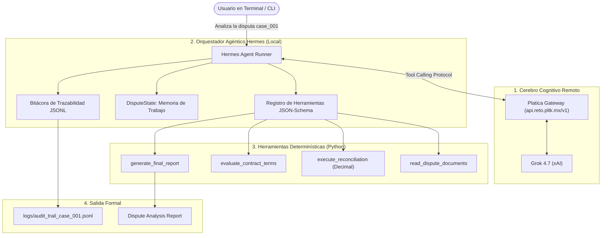

# SupplyMind AI 🧠📦
> **Analista Digital Autónomo de Disputas Comerciales en Cadenas de Suministro B2B**  
> *Proyecto desarrollado para el **Reto Agente 2026** (Platica.mx × Campuslands) sobre la arquitectura **Hermes Agent** y el motor de razonamiento **Grok 4.7 (xAI)**.*

---

## 📌 1. El Problema

En las cadenas de suministro B2B (fabricantes, distribuidores y grandes cadenas de retail), las entregas de mercancía generan continuamente **discrepancias financieras y operativas** entre:
- **Factura Comercial emitida (`invoice.json`)**
- **Orden de Compra pactada (`purchase_order.json`)**
- **Remisión o comprobante de entrega en bodega (`delivery.json`)**
- **Comprobante de pago bancario y deducciones (`payment.json`)**
- **Contrato comercial y acuerdos de servicio (`contract.json`)**

### Tipologías de Excepciones:
1. **Faltantes físicos de mercancía** (unidades facturadas que no llegaron a muelle).
2. **Mercancía dañada o averiada** (rechazada durante el descargue).
3. **Diferencias de precio unitario** (precios de factura superiores a la orden de compra).
4. **Deducciones no autorizadas** por pronto pago o penalizaciones logísticas indebidas.

Actualmente, estos casos exigen análisis manual de equipos de cartera, logística y contabilidad, retrasando cobros, generando fricción comercial y pérdidas financieras.

---

## 🚀 2. La Solución: SupplyMind AI

**SupplyMind AI** es un agente autónomo que opera como un **Analista Digital Senior de Conciliación**.
Dado un objetivo en lenguaje natural:
```bash
python main.py "Analiza la disputa case_001"
```
El agente:
1. **Analiza el objetivo** y planifica los pasos necesarios.
2. **Selecciona e invoca herramientas** de forma dinámica (no un script secuencial rígido).
3. **Ejecuta conciliación matemática determinística** línea a línea (cantidades, precios, faltantes y deducciones).
4. **Contrasta la evidencia física contra el contrato** para evaluar la validez jurídica de las deducciones.
5. **Genera el `Dispute Analysis Report`** con la causa raíz, evidencia documental y acción recomendada.
6. **Registra trazabilidad completa** de cada decisión en una bitácora auditable (`logs/audit_trail_case_001.jsonl`).

---

## ⚖️ 3. Principio de Cero Alucinación Financiera

> [!IMPORTANT]
> **Separación Estricta entre Cognición y Cálculo:**  
> Ninguna suma, resta de saldo, cálculo de subtotales ni conciliación de cantidades es delegada a la predicción probabilística de texto del LLM.  
> Los cálculos matemáticos se ejecutan exclusivamente en un **Motor Determinístico en Python** utilizando precisión exacta (`Decimal`). Grok (xAI) utiliza estos resultados verificados para interpretar las causas, evaluar cláusulas contractuales y formular la resolución comercial.

---

## 🏗️ 4. Arquitectura del Agente sobre Hermes y Grok



---

## 📂 5. Estructura del Repositorio

```
platica/
├── .env                              # Variables de entorno locales (ignorado en git)
├── .env.example                      # Plantilla de configuración pública
├── .gitignore                        # Archivos excluidos de git
├── README.md                         # Documentación integral del proyecto
├── requirements.txt                  # Dependencias del proyecto
├── main.py                           # CLI interactivo enriquecido
│
├── config/
│   ├── __init__.py
│   └── settings.py                   # Carga de variables de entorno y paths
│
├── data/
│   ├── __init__.py
│   ├── models.py                     # Modelos Pydantic para Invoice, PO, Delivery, Payment, Report
│   └── cases/
│       └── case_001/                 # Caso de prueba MVP
│           ├── invoice.json          # Facturado: $9,000.00 USD
│           ├── purchase_order.json   # PO acordada: $9,000.00 USD
│           ├── delivery.json         # Remisión con faltante firmado de 10 cajas
│           ├── payment.json          # Pago recibido: $8,200.00 USD (deducción -$800.00 USD)
│           └── contract.json         # Cláusula 4.2 autoriza deducción de faltante físico
│
├── tools/
│   ├── __init__.py
│   ├── document_reader/              # Lector y validador de expedientes JSON
│   ├── reconciliation_engine/        # Motor determinístico de conciliación exacta (Decimal)
│   ├── contract_analyzer/            # Evaluador de cumplimiento contractual
│   └── report_generator/             # Ensamblador del reporte formal
│
├── agent/
│   ├── __init__.py
│   ├── core/
│   │   ├── hermes_runner.py          # Orquestador del bucle agéntico Hermes con Grok
│   │   └── state.py                  # Estado del proceso y memoria de trabajo
│   ├── planner/
│   │   └── prompts.py                # Directrices de Analista Senior B2B
│   ├── memory/
│   │   └── audit_logger.py           # Bitácora auditable paso a paso (JSONL)
│   └── tools/
│       └── registry.py               # Definición formal de herramientas (JSON-Schema)
│
├── tests/
│   ├── test_models.py                # Pruebas de modelos Pydantic
│   ├── test_case_001.py              # Pruebas del dataset sintético
│   ├── test_tools.py                 # Pruebas de las 4 herramientas determinísticas
│   └── test_agent.py                 # Pruebas de integración del bucle Hermes y Grok
│
└── logs/                             # Bitácoras de auditoría generadas en ejecución
```

---

## ⚙️ 6. Instalación y Puesta en Marcha

### Requisitos Previos:
- Python 3.10 o superior (validado en Python 3.14).

### 1. Clonar e instalar entorno virtual:
```bash
python -m venv .venv
.\.venv\Scripts\activate
pip install -r requirements.txt
```

### 2. Configurar credenciales del Reto Platica:
Copia la plantilla `.env.example` a `.env`:
```bash
cp .env.example .env
```
Y añade tu API Key asignada por Platica:
```env
RETO_KEY=pk_tu_llave_aqui
PLATICA_BASE_URL=https://api.reto.pltk.mx/v1
MODEL_NAME=grok-4.7
DEFAULT_CURRENCY=USD
```

---

## ⚡ 6.1 Guía Rápida para Jurados y Evaluadores (30 Segundos)

Para evaluar **todo el proyecto de forma desatendida e instantánea**, ejecuta un solo comando:
```bash
python main.py evaluar
# o directamente:
python scripts/evaluar_jurado.py
```

### Lo que este comando verifica automáticamente en ~3 segundos:
1. **Entorno & Credenciales:** Conexión con Platica Gateway y modelo `grok-4.7`.
2. **51 Pruebas Automatizadas:** 100% de éxito en la suite `pytest`.
3. **Resolución de los 3 Casos B2B:** `case_001` ($9K), `case_002` ($54.2K) y `case_003` ($15K).
4. **Entregables de Negocio Generados:** Informes ejecutivos y **Carta Formal de Reclamación** de $12,500 USD en [reports/](file:///c:/Users/USUARIO/Downloads/platica/reports/).
5. **Unit Economics:** Demostración de costo real de inferencia (< $0.005 USD por expediente).

---

## 🏃 7. Ejecución del Agente

Para analizar el caso de prueba `case_001`:
```bash
python main.py "Analiza la disputa case_001"
```

### Salida esperada en terminal:
```text
┌────────────────────────────────────────────────────────────────┐
│ SupplyMind AI - Analista Autonomo de Disputas B2B              │
│ Reto Agente Platica.mx x Campuslands - Powered by Hermes Agent │
└────────────────────────────────────────────────────────────────┘
Iniciando analisis para: case_001

Turno 1: Consultando a Grok (grok-4.7)...
-> Invocando herramienta: read_dispute_documents con {'case_id': 'case_001'}
Turno 2: Consultando a Grok (grok-4.7)...
-> Invocando herramienta: execute_reconciliation con {'case_id': 'case_001'}
Turno 3: Consultando a Grok (grok-4.7)...
-> Invocando herramienta: evaluate_contract_terms con {'case_id': 'case_001'}
Turno 4: Consultando a Grok (grok-4.7)...
-> Invocando herramienta: generate_final_report con {...}

                            DISPUTE ANALYSIS REPORT                            
┌──────────────────────────┬──────────────────────────────────────────────────┐
│ Caso analizado           │ case_001                                         │
│ Monto facturado          │ $9,000.00 USD                                    │
│ Monto recibido           │ $8,200.00 USD                                    │
│ Diferencia               │ $-800.00 USD                                     │
│ Causa encontrada         │ La diferencia de $800.00 se origina              │
│                          │ exclusivamente en un faltante físico de          │
│                          │ mercancía acreditado en remisión DEL-9912        │
│                          │ (10 unidades de PROD-002 × $80.00 = $800.00)...  │
│ Evidencia utilizada      │ - Faltante físico comprobado en PROD-002: 10     │
│                          │   unidades s/ remisión DEL-9912 ($800.00)        │
│                          │ - Deducción aplicada en comprobante PAY-7710     │
│                          │ - Respaldo contractual: CLAUSE-4.2 autoriza      │
│                          │   deducción ante constancia firmada en remisión  │
│ Monto justificado        │ $800.00 USD                                      │
│ Monto reclamable         │ $0.00 USD                                        │
│ Nivel de confianza       │ 98.0%                                            │
│ Accion recomendada       │ Aceptar deducción en cartera y emitir Nota de    │
│                          │ Crédito comercial por $800.00 USD para conciliar │
│                          │ y cerrar la cuenta. No iniciar cobro coactivo.   │
└──────────────────────────┴──────────────────────────────────────────────────┘

[OK] Trazabilidad y bitacora de decisiones guardada en: logs/audit_trail_case_001.jsonl
[OK] Analisis completado exitosamente.
```

### 💬 Modos Avanzados de Interacción:

#### 1. Terminal de Control y Chat Interactivo (Menú Expandido):
Inicia el centro de comando interactivo del analista:
```bash
python main.py -i
# o especificando el caso:
python main.py -i case_001
```
El menú interactivo te ofrece **8 opciones directas** además de chat libre en lenguaje natural:
- `[1] 🧠 Analizar Disputa`: Ejecuta el ciclo autónomo ReAct con Grok paso a paso.
- `[2] 📊 Ver Reporte Formal`: Despliega la tabla formal del dictamen (`Dispute Analysis Report`).
- `[3] 📂 Inspeccionar Documentos`: Explora a fondo el expediente (Factura, OC, Remisión, Pago y Contrato).
- `[4] 🔢 Conciliación Detallada`: Auditoría matemática línea a línea de unidades, precios e impactos en `Decimal`.
- `[5] ⚖️ Dictamen Contractual`: Tabla de cumplimiento de cláusulas comerciales (CLAUSE-4.2, etc.).
- `[6] 📜 Bitácora de Auditoría`: Visor de los últimos eventos registrados en la bitácora JSONL.
- `[7] 🎯 Calibrar Criterio AI`: Ejecuta el benchmark de entrenamiento y evaluación de criterio con control de presupuesto.
- `[8] 🔄 Cambiar / Recargar Caso`: Permite alternar de expediente activo en caliente.
- `[0] 🚪 Salir`: Finaliza la sesión guardando la bitácora de auditoría.
- *O escribe cualquier pregunta libre a Grok en cualquier momento (ej. "¿Por qué el cliente retuvo $800?").*

#### 2. Calibración y Entrenamiento de Criterio (< $1.00 USD):
Evalúa y calibra el razonamiento de Grok frente a la matriz de criterios senior B2B (cero alucinación, rigor probatorio, alineación contractual y mitigación de riesgo):
```bash
python main.py calibrar
# o mediante el script directo:
python scripts/calibrate_agent.py case_001
```
*Métricas reales de la batería de calibración:*
- **Puntaje Global de Criterio:** `100.0 / 100.0 (CALIBRADO)`
- **Tokens Consumidos:** `6,530 tokens`
- **Gasto Total:** `~$0.02666 USD` (menos de 3 centavos de dólar sobre un tope de $1.00 USD).

#### 3. Consulta Puntual desde Línea de Comandos (One-Liner):
Haz preguntas específicas directamente desde tu terminal:
```bash
python main.py ask case_001 "¿Por qué el cliente aplicó una deducción de 800 dólares?"
python main.py ask case_002 "¿Cuánto dinero podemos reclamar legalmente al cliente y por qué?"
```

#### 4. Casos de Prueba Disponibles:
- **`case_001` (Básico):** Factura de $9,000.00 USD, 2 productos. Faltante físico de 10 cajas ($800.00 USD) 100% justificado en Cláusula 4.2. Saldo reclamable: **$0.00 USD**.
- **`case_002` (Complejo - Alta Cuantía):** Factura de $54,200.00 USD, 4 productos de alto valor. Diferencia de -$16,500.00 USD descompuesta en:
  * $4,000.00 USD justificados (50 cajas faltantes de PROD-102 en remisión DEL-12044 a $80.00 c/u según Cláusula 4.2).
  * $6,500.00 USD injustificados (supuesta avería de PROD-103 no acreditada en muelle ni reportada en 48h según Cláusula 5.1).
  * $6,000.00 USD injustificados (penalización administrativa unilateral prohibida por Cláusula 7.3).
  * **Saldo reclamable:** **$12,500.00 USD** (genera automáticamente la *Carta Formal de Reclamación* en [reports/carta_reclamacion_case_002.md](file:///c:/Users/USUARIO/Downloads/platica/reports/)).
- **`case_003` (Discrepancia de Precio Unitario):** Factura de $15,000.00 USD vs Orden de Compra de $12,000.00 USD. Sobreprecio de $30.00 USD/u facturado en 100 cajas de PROD-301. Deducción de $3,000.00 USD 100% justificada por el comprador conforme a Cláusula 3.1 (*Inalterabilidad de Precios*). Saldo reclamable: **$0.00 USD**.

---

## 📑 8. Entregables de Negocio Generados (`reports/`)

Cada análisis genera automáticamente artefactos ejecutivos listos para enviar a cartera o al cliente:
1. **Informe Formal en Markdown (`reports/dispute_report_<case_id>.md`):** Diagnóstico completo, tablas financieras, causa raíz y dictamen legal.
2. **Exportación Estructurada (`reports/dispute_report_<case_id>.json`):** Payload de integración para ERP o sistema de cobranza.
3. **Carta Formal de Reclamación Comercial (`reports/carta_reclamacion_<case_id>.md`):** Cuando existe saldo reclamable (ej. $12,500 USD en `case_002`), redacta una carta formal con membrete, fundamentación jurídica y plazo de 15 días hábiles.

---

## 🧪 9. Pruebas Automatizadas

Ejecuta la suite completa de pruebas:
```bash
pytest -v
```
Resultado:
```text
51 passed in 1.05s (100% de pruebas exitosas)
```

---

## 📋 10. Estado del Proyecto (Hito S1 Completado al 100% & Avanzando en Hito S2)

- [x] **Hito S1 (Semana 1 - Agente Corriendo, Calibrado & Blindado para Jurados):**
  - [x] Suite de evaluación instantánea para jurados (`python main.py evaluar`).
  - [x] Arquitectura basada en Hermes Agent con Grok 4.7 vía Platica Gateway.
  - [x] Motor de conciliación determinístico en `Decimal` (cero alucinaciones).
  - [x] Matriz de casos B2B completa: `case_001` ($9K), `case_002` ($54.2K) y `case_003` ($15K).
  - [x] Generación de entregables formales (Reportes Markdown/JSON y Carta de Reclamación de $12.5k).
  - [x] Reporte formal `Dispute Analysis Report` completo con trazabilidad JSONL.
  - [x] Terminal interactiva expandida (8 comandos de inspección y chat REPL).
  - [x] Módulo de entrenamiento y calibración de criterio (< $1.00 USD).
  - [x] 51 pruebas automatizadas pasando en verde al 100% (< 1.1s).
- [ ] **Hito S2 (Semana 2 - Herramientas Reales y Robustez):**
  - [x] Soporte para discrepancias mixtas (faltante físico + avería extemporánea + penalización arbitraria en `case_002`).
  - [x] Soporte para discrepancias de precio unitario en `case_003`.
  - [ ] Ingesta de archivos PDF/OCR y carga dinámica de expedientes externos.
  - [ ] Manejo de expedientes incompletos y excepciones.
- [ ] **Hito S3 (Semana 3 - Evaluación Masiva):**
  - Dataset de 30+ casos de prueba reales/sintéticos.
  - Reporte de costo por tarea y consumo de tokens.
- [ ] **Hito S4 (Semana 4 - Semana de Carga y Track 2):**
  - Procesamiento batch desatendido de 1,000 unidades de trabajo.
  - Preparación de unit economics y modelo de negocio sobre Platica.mx.
