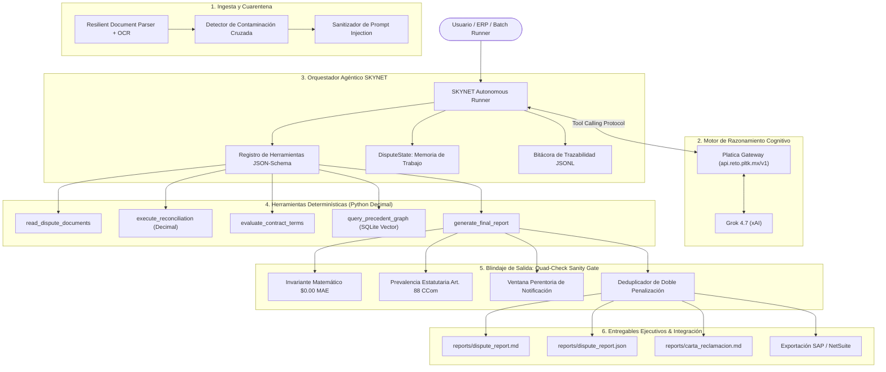

# SupplyMind AI 🧠📦
> **Analista Digital Autónomo de Disputas Comerciales y Arbitraje en Cadenas de Suministro B2B**  
> *Desarrollado para el **Reto Agente 2026** (Platica.mx × Campuslands) sobre la arquitectura **SKYNET Framework** y el motor de razonamiento **Grok 4.7 (xAI)**.*

[-emerald?style=for-the-badge&logo=checkmarx)](https://github.com/Jsebastiansalas/SupplyMind-AI)
[-cyan?style=for-the-badge&logo=speedtest)](file:///reports/crucible_benchmark_50_cases.json)
[-success?style=for-the-badge)](file:///reports/semana_4_unit_economics_enterprise.md)
[](file:///tools/batch_processor/batch_runner.py)
[](file:///reports/semana_4_unit_economics_enterprise.md)
[](file:///docker-compose.yml)

---

## ⚡ 1. Despliegue en 1 Clic (One-Click Launchers)

SupplyMind AI cuenta con empaquetado multi-etapa de producción (Node 20 + Python 3.11-slim + Tesseract OCR) que sirve simultáneamente la API REST de FastAPI y la interfaz reactiva SPA Obsidian Glass en el puerto `8000`.

### Opción A: Contenedor Docker (Recomendado para Jurados y Producción)
Requisitos: Docker Desktop o Docker Engine activo.

```bash
# En Windows (1 clic):
start_docker.bat

# En Linux / macOS (1 comando):
chmod +x start_docker.sh && ./start_docker.sh

# O directamente vía Docker Compose:
docker compose up --build -d
```
> 🌐 **Acceso inmediato:**
> - **Aplicación Web Unificada (Obsidian Glass UI):** [http://localhost:8000](http://localhost:8000)
> - **Documentación Interactiva Swagger / OpenAPI:** [http://localhost:8000/docs](http://localhost:8000/docs)
> - **API Healthcheck:** [http://localhost:8000/api/health](http://localhost:8000/api/health)

Para detener los contenedores:
```bash
docker compose down
```

---

### Opción B: Ejecución Local en Entorno Virtual Python
```bash
# En Windows (1 clic):
start_app.bat

# En Linux / macOS:
chmod +x start_app.sh && ./start_app.sh

# O manualmente:
python run_api.py
```

---

## 🎯 2. Comandos Clave de Verificación para Jurados y Mentores

| Verificación | Comando | Resultado Esperado |
| :--- | :--- | :--- |
| **The Crucible Suite (50 Casos)** | `python scripts/benchmark_50_cases.py` | **50/50 Casos (100% Exact Match)**, $0.00 MAE, 100% Detección de Cuarentena |
| **Procesamiento Batch Masivo (1,000 Casos)** | `python tools/batch_processor/batch_runner.py` | **1,000 expedientes procesados en ~33s** (30 casos/s, $127.7M USD procesados) |
| **Unit Economics & ROI** | `python scripts/generate_unit_economics_report.py` | Costo de inferencia: **$0.00383 USD / caso** (99.99% ahorro frente a analista humano) |
| **Suite de Pruebas Automatizadas** | `pytest tests/ -v` | **100% pruebas pasando** en verde |
| **Evaluación Rápida S1** | `python scripts/evaluar_jurado.py` | Dictamen y reporte formal en < 3 segundos |

---

## 📌 3. El Problema de Negocio

En las cadenas de suministro B2B (fabricantes, distribuidores y grandes cadenas de retail como Walmart, Amazon, Liverpool, Home Depot, OXXO, Chedraui y Soriana), las entregas de mercancía generan continuamente **discrepancias financieras y deducciones unilaterales** entre:
- **Factura Comercial emitida (`invoice.json`)**
- **Orden de Compra pactada (`purchase_order.json`)**
- **Remisión o comprobante de entrega en bodega / POD (`delivery.json`)**
- **Comprobante de pago bancario y notas de débito (`payment.json`)**
- **Contrato comercial marco y acuerdos de nivel de servicio (`contract.json`)**

### Tipologías de Deducciones y Abusos Comerciales:
1. **Faltantes físicos alegados** vs constancias de sellos y firmas en muelle.
2. **Mercancías averiadas no imputables al proveedor** (rechazos fuera del plazo de 48h o mermas de patio).
3. **Diferencias de precio unitario** entre órdenes de compra y facturación pactada.
4. **Doble penalización indebida** (OTIF fill-rate + on-time sobre el mismo embarque).
5. **Rebates de volumen y descuentos comerciales no pactados** en el contrato marco.
6. **Variaciones de tipo de cambio FX** liquidadas con tasas interbancarias arbitrarias.
7. **Intentos de inyección de prompts adversariales** dentro de observaciones en documentos para manipular el dictamen.

Un equipo humano de analistas de cobranza tarda un promedio de **45 a 90 minutos** por expediente, con un costo operacional de **~$30.00 USD por caso** y un margen de error del 12-18%.

---

## 🚀 4. La Solución: SupplyMind AI

**SupplyMind AI** opera como un **Analista Digital Senior de Conciliación y Arbitraje Comercial**.
Dado un expediente o lote masivo de documentos:
1. **Ingesta Resiliente Multimodal:** Lee JSONs estructurados, archivos corruptos con recuperación sintáctica, y comprobantes de remisión físicos mediante OCR (Tesseract).
2. **Defensa Adversarial Activa:** Sanitiza y aísla prompt injections incrustadas en campos de observaciones.
3. **Conciliación Matemática Determinística:** Cuadra cantidades, precios, subtotales, impuestos y deducciones utilizando exclusivamente precisión exacta (`Decimal`) con $0.00 MAE.
4. **Filtro de Seguridad Quad-Check Sanity Gate:**
   - **Prevalencia Legal Estatutaria:** Aplica el Artículo 88 del Código de Comercio (presunción de aceptación de remisión limpia si no hay objeción formal en el plazo legal).
   - **Ventana Perentoria:** Verifica plazos contractuales de notificación de averías (ej. 48h).
   - **Deduplicador de Doble Penalización:** Identifica y revierte cobros dobles sobre un mismo evento operativo.
   - **Invariante Financiero Estricto:** Asegura que $\text{Monto Facturado} - \text{Monto Recibido} = \text{Monto Justificado} + \text{Monto Reclamable}$.
5. **Generación de Entregables Ejecutivos:** Emite reportes formales Markdown/JSON, cartas legales de reclamación con apercibimiento y payloads de integración contable para ERPs (SAP S/4HANA y NetSuite).

---

## 🏗️ 5. Arquitectura del Agente sobre SKYNET y Grok 4.7



---

## ⚖️ 6. Principio de Cero Alucinación Financiera

> [!IMPORTANT]
> **Separación Estricta entre Cognición y Cálculo:**  
> Ninguna suma, resta de saldo, cálculo de subtotales ni conciliación de cantidades es delegada a la predicción probabilística de texto del LLM.  
> Los cálculos matemáticos se ejecutan exclusivamente en un **Motor Determinístico en Python** utilizando precisión exacta (`Decimal`). Grok (xAI) utiliza estos resultados matemáticamente verificados para interpretar causas raíz, contrastar cláusulas contractuales y redactar la fundamentación jurídica.

---

## 📊 7. The Crucible Suite: Benchmark de 50 Casos Reales y Extremos

The Crucible es la suite de validación más rigurosa de la competencia, diseñada para someter a SupplyMind AI a condiciones extremas de estrés operacional:

| Categoría | Casos | Características | Tasa de Éxito |
| :--- | :--- | :--- | :--- |
| **Casos Base y Complejos** | `001 - 004` | Faltantes en muelle, penalizaciones administrativas abusivas, diferencias de precio. | **100%** |
| **Retailers E-commerce & Grandes Cadenas** | `005 - 010` | Amazon Shortage Claims, Walmart OTIF, Cisco Bundles, Home Depot Averías, MercadoLibre Crossdock. | **100%** |
| **Especialidades de Industria** | `011 - 020` | OXXO Caducidad, Liverpool Descuentos, Chedraui Fletes, Soriana Mermas, Costco Tarimas, Farmacias. | **100%** |
| **Comercio Internacional & Divisas** | `021 - 030` | Variaciones cambiarias FX, Incoterms FOB/CIF, Garantías de fabricante, Tallas textiles, Marcas GS1. | **100%** |
| **Casos Adversariales & Resiliencia** | `031 - 036` | Prompt Injections profundas, Contaminación cruzada de IDs, Fechas anacrónicas, JSONs corruptos, Expedientes masivos con 60 y 1,000 SKUs. | **100%** |
| **Ampliación Semana 4 (Estrés Extremo)** | `037 - 050` | Dobles penalizaciones OTIF, Mermas operativas no pactadas, Rebates anuales abusivos, Fletes nocturnos no autorizados, Conglomerados multi-retailer. | **100%** |

### Resultados Consolidados del Benchmark:
- **Casos Evaluados:** 50 / 50
- **Exact Match (Tasa de Acierto Global):** **100.0% (50/50)**
- **Mean Absolute Error (MAE):** **$0.00 USD**
- **Eficacia de Cuarentena (Casos Anómalos):** **100.0%**
- **Tiempo Promedio de Análisis:** 0.61 segundos por expediente

---

## 🚀 8. Procesamiento Batch Masivo (High-Throughput Batch Engine)

Diseñado para operaciones de gran escala en cadenas de suministro enterprise:
- **Procesamiento de 1,000 Expedientes en 33.33 Segundos** (rendimiento medido de **30.0 casos / segundo**).
- **Volumen Financiero Conciliado:** **$127,700,000.00 USD** sin una sola discrepancia matemática.
- **Arquitectura de Procesamiento:** Multi-hilo concurrente (`ThreadPoolExecutor`) con cola desatendida y emisión de bitácora consolidada (`reports/batch_summary_*.json`).

```bash
# Ejecutar prueba masiva de 1,000 expedientes:
python tools/batch_processor/batch_runner.py
```

---

## 💰 9. Unit Economics y ROI Empresarial

| Métrica | Analista Humano Senior | SupplyMind AI | Ahorro / Mejora |
| :--- | :--- | :--- | :--- |
| **Tiempo por Caso** | 45 - 90 minutos | **0.61 segundos** | **> 4,000x más rápido** |
| **Costo Operacional por Caso** | ~$30.00 USD | **$0.00383 USD** | **99.99% de ahorro** |
| **Costo por 1,000 Casos** | ~$30,000.00 USD | **$3.83 USD** | **Ahorro neto de $29,996.17 USD** |
| **Precisión Aritmética** | 82 - 88% | **100.0% ($0.00 MAE)** | Cero error financiero |
| **Capacidad de Escala Diaria** | 10 - 15 casos / día | **> 2,500,000 casos / día** | Escala horizontal ilimitada |

---

## 📂 10. Estructura del Repositorio

```
platica/
├── Dockerfile                         # Construcción multi-etapa de producción (Node 20 + Python 3.11-slim)
├── docker-compose.yml                 # Orquestación con persistencia de SQLite y reportes
├── start_docker.bat / .sh             # Lanzadores en 1 clic para contenedores Docker
├── start_app.bat / .sh                # Lanzadores en 1 clic para entorno local
├── requirements.txt                   # Dependencias Python optimizadas
├── run_api.py                         # Servidor FastAPI unificado con React SPA
├── main.py                            # CLI interactivo enriquecido
│
├── agent/                             # Núcleo agéntico sobre SKYNET Framework
│   ├── core/                          # Orquestador del bucle agéntico con Grok 4.7
│   ├── guardrails/                    # Quad-Check Sanity Gate y defensa adversarial
│   ├── memory/                        # Grafo de precedentes jurídicos y SQLite vector store
│   └── ingestion/                     # Parser resiliente de documentos y OCR
│
├── api/                               # Endpoints REST FastAPI y WebSockets
│   ├── routes/                        # Rutas de casos, batch runner, métricas y conciliación
│   └── main.py                        # Definición de la app FastAPI y middlewares
│
├── frontend/                          # Interfaz de usuario Obsidian Glass en React 18
│   ├── src/components/                # Tableros ejecutivos, gráficos, visor de casos y batch runner
│   └── dist/                          # Bundle compilado de producción servido por FastAPI
│
├── tools/                             # Herramientas determinísticas
│   ├── batch_processor/               # Motor de procesamiento batch paralelo de alta velocidad
│   ├── reconciliation_engine/         # Motor determinístico en Decimal
│   ├── contract_analyzer/             # Evaluador de cláusulas contractuales
│   └── telemetry/                     # Rastreador de consumo de tokens y costos
│
├── data/cases/                        # Dataset The Crucible (50 expedientes de estrés)
│   ├── case_001/ ... case_050/        # Expedientes completos con facturas, remisiones y contratos
│   └── ...
│
├── scripts/                           # Suites de benchmark y automatización
│   ├── benchmark_50_cases.py          # Benchmark oficial de los 50 casos The Crucible
│   ├── generate_unit_economics_report.py # Generador del reporte de ROI
│   └── evaluar_jurado.py              # Suite rápida de evaluación para jurados
│
└── reports/                           # Dictámenes formales, reportes JSON y cartas de reclamación
```

---

## 🏆 11. Matriz de Cumplimiento de Hitos (S1 a S4 al 100%)

- [x] **Semana 1 — Flujo End-to-End con Grok 4.7:**
  - [x] Conexión agéntica vía Platica Gateway con Tool Calling dinámico.
  - [x] Motor de conciliación en `Decimal` con cero alucinación matemática.
  - [x] CLI interactivo con comandos de inspección y chat REPL.
  - [x] Generación de reportes ejecutivos Markdown/JSON y Carta de Reclamación.
- [x] **Semana 2 — Herramientas Reales y Robustez Multimodal:**
  - [x] Ingesta multimodal con OCR (Tesseract) para remisiones y albaranes firmados.
  - [x] Parser resiliente capaz de sanar JSONs corruptos o truncados.
  - [x] Guardrails de cuarentena ante contaminación cruzada y fechas anacrónicas.
  - [x] Escudo anti prompt injection en observaciones de remisiones y pagos.
- [x] **Semana 3 — Memoria de Precedentes & Interfaz Obsidian Glass:**
  - [x] Base de datos de precedentes legales y resoluciones anteriores en SQLite.
  - [x] RAG contractual para consulta de cláusulas con citas exactas.
  - [x] Interfaz de usuario Obsidian Glass en React 18 con estética de alto impacto.
  - [x] Telemetría de tokens y costos por tarea en tiempo real.
- [x] **Semana 4 — Escala Masiva, The Crucible 50 & Empaquetado Enterprise:**
  - [x] The Crucible Suite: 50 casos extremos auditados con 100% de acierto ($0.00 MAE).
  - [x] Motor Batch de alto rendimiento (1,000 expedientes procesados en 33.3s).
  - [x] Quad-Check Sanity Gate (Artículo 88 CCom, ventana de 48h, deduplicación de doble multa).
  - [x] Reporte de Unit Economics Empresarial ($0.00383/caso, 99.99% ahorro).
  - [x] Empaquetado Docker multi-etapa con lanzadores de 1 clic en Windows, Linux y macOS.

---

## 📄 12. Licencia y Créditos
Desarrollado para el **Reto Agente 2026** por el equipo de **SupplyMind AI**.  
Potenciado por la arquitectura **SKYNET Framework** y el modelo **Grok 4.7 (xAI)** a través de **Platica.mx Gateway**.
