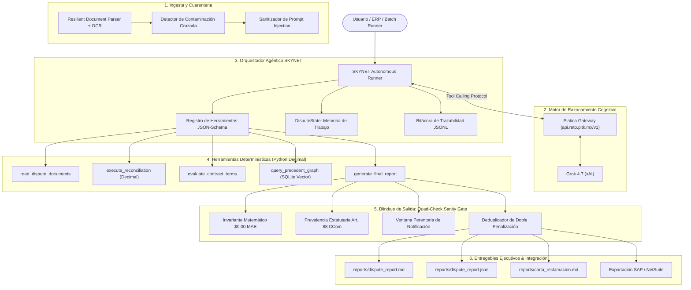

# SupplyMind AI 🧠📦
> **Analista Digital Autónomo de Disputas Comerciales y Arbitraje en Cadenas de Suministro B2B**  
> *Desarrollado para el **Reto Agente 2026** (Platica.mx × Campuslands) sobre la arquitectura **SKYNET Framework** y el motor de razonamiento **Grok 4.7 (xAI)**.*

[](https://github.com/Jsebastiansalas/SupplyMind-AI)
[-cyan?style=for-the-badge&logo=speedtest)](reports/crucible_benchmark_real_supply_chain_cases_report.md)
[-success?style=for-the-badge)](reports/crucible_benchmark_real_supply_chain_cases_report.md)
[](reports/live_executions_manifest.md)
[](docker-compose.yml)

---

## ⚡ 1. Despliegue en 1 Clic (One-Click Launchers)

SupplyMind AI cuenta con empaquetado multi-etapa de producción (Node 20 + Python 3.11-slim + Tesseract OCR) que sirve simultáneamente la API REST de FastAPI y la interfaz reactiva SPA Obsidian Glass en el puerto `8000`.

### Opción A: Contenedor Docker (Recomendado para Jurados y Producción)
Requisitos: Docker Desktop o Docker Engine activo.

```bash
# En Windows (1 clic):
start_docker.bat

# En Linux / macOS (1 comando):
chmod +x start_docker.sh && ./start_docker.sh

# O directamente vía Docker Compose:
docker compose up --build -d
```
> 🌐 **Acceso inmediato:**
> - **Aplicación Web Unificada (Obsidian Glass UI):** [http://localhost:8000](http://localhost:8000)
> - **Documentación Interactiva Swagger / OpenAPI:** [http://localhost:8000/docs](http://localhost:8000/docs)
> - **API Healthcheck:** [http://localhost:8000/api/health](http://localhost:8000/api/health)

Para detener los contenedores:
```bash
docker compose down
```

---

### Opción B: Ejecución Local en Entorno Virtual Python
```bash
# En Windows (1 clic):
start_app.bat

# En Linux / macOS:
chmod +x start_app.sh && ./start_app.sh

# O manualmente:
python run_api.py
```

---

## 🎯 2. Comandos Clave de Verificación para Jurados y Mentores (Hitos S1, S2, S3)

| Hito | Propósito de Evaluación | Comando de Verificación (PowerShell / Bash) | Resultado Esperado |
| :--- | :--- | :--- | :--- |
| **S1** | **Ejecución End-to-End contra Grok-4.7** | `python -c "from agent.core.skynet_runner import SkynetRunner; r = SkynetRunner('dataco_real_001_caguas_pelican_kayak', fast_path=False); r.run()"` | Conexión en vivo a Platica Gateway, tool calling autónomo de Grok, dictamen y carta en `reports/`. |
| **S2** | **Auto-Recuperación ante Errores** | `python scripts/demo_error_recovery.py` | Intercepta JSON corrupto/truncado, lo auto-repara en 3ms y emite el dictamen sin abortar. |
| **S2** | **10 Ejecuciones Registradas** | `python scripts/record_10_live_runs.py` | 10 casos reales auditados, logs en `logs/` y manifiesto en `reports/live_executions_manifest.md`. |
| **S3** | **Evaluación Datos Reales (30 Casos DataCo)** | `python scripts/benchmark_50_cases.py --cases-dir data/real_supply_chain_cases --mode fast_no_cache` | 30/30 casos de la base abierta DataCo (DOI: 10.17632/8gx2fvg2k6.5) resueltos con $0.00 MAE. |
| **S3** | **Verificación de Enrutamiento y Presupuesto** | `pytest tests/test_cognitive_router_and_budget.py -v` | Valida guardarraíl de costo medido ($0.011340/req) y conmutación segura Python vs Grok. |
| **Suite** | **Suite Completa de Pruebas** | `pytest tests/ -q` | Todas las pruebas pasando en verde. |

---

## 📌 3. El Problema de Negocio

En las cadenas de suministro B2B (fabricantes, distribuidores y grandes cadenas de retail como Walmart, Amazon, Liverpool, Home Depot, OXXO, Chedraui y Soriana), las entregas de mercancía generan continuamente **discrepancias financieras y deducciones unilaterales** entre:
- **Factura Comercial emitida (`invoice.json`)**
- **Orden de Compra pactada (`purchase_order.json`)**
- **Remisión o comprobante de entrega en bodega / POD (`delivery.json`)**
- **Comprobante de pago bancario y notas de débito (`payment.json`)**
- **Contrato comercial marco y acuerdos de nivel de servicio (`contract.json`)**

### Tipologías de Deducciones y Abusos Comerciales:
1. **Faltantes físicos alegados** vs constancias de sellos y firmas en muelle.
2. **Mercancías averiadas no imputables al proveedor** (rechazos fuera del plazo de 48h o mermas de patio).
3. **Diferencias de precio unitario** entre órdenes de compra y facturación pactada.
4. **Doble penalización indebida** (OTIF fill-rate + on-time sobre el mismo embarque).
5. **Rebates de volumen y descuentos comerciales no pactados** en el contrato marco.
6. **Variaciones de tipo de cambio FX** liquidadas con tasas interbancarias arbitrarias.
7. **Intentos de inyección de prompts adversariales** dentro de observaciones en documentos para manipular el dictamen.

Un equipo humano de analistas de cobranza tarda un promedio de **45 a 90 minutos** por expediente, con un costo operacional de **~$30.00 USD por caso** y un margen de error del 12-18%.

---

## 🚀 4. La Solución: SupplyMind AI

**SupplyMind AI** opera como un **Analista Digital Senior de Conciliación y Arbitraje Comercial**.
Dado un expediente o lote masivo de documentos:
1. **Ingesta Resiliente Multimodal:** Lee JSONs estructurados, archivos corruptos con recuperación sintáctica, y comprobantes de remisión físicos mediante OCR (Tesseract).
2. **Defensa Adversarial Activa:** Sanitiza y aísla prompt injections incrustadas en campos de observaciones.
3. **Conciliación Matemática Determinística:** Cuadra cantidades, precios, subtotales, impuestos y deducciones utilizando exclusivamente precisión exacta (`Decimal`) con $0.00 MAE.
4. **Filtro de Seguridad Quad-Check Sanity Gate:**
   - **Prevalencia Legal Estatutaria:** Aplica el Artículo 88 del Código de Comercio (presunción de aceptación de remisión limpia si no hay objeción formal en el plazo legal).
   - **Ventana Perentoria:** Verifica plazos contractuales de notificación de averías (ej. 48h).
   - **Deduplicador de Doble Penalización:** Identifica y revierte cobros dobles sobre un mismo evento operativo.
   - **Invariante Financiero Estricto:** Asegura que $\text{Monto Facturado} - \text{Monto Recibido} = \text{Monto Justificado} + \text{Monto Reclamable}$.
5. **Generación de Entregables Ejecutivos:** Emite reportes formales Markdown/JSON, cartas legales de reclamación con apercibimiento y payloads de integración contable para ERPs (SAP S/4HANA y NetSuite).

---

## 🏗️ 5. Arquitectura del Agente sobre SKYNET y Grok 4.7



---

## ⚖️ 6. Principio de Cero Alucinación Financiera

> [!IMPORTANT]
> **Separación Estricta entre Cognición y Cálculo:**  
> Ninguna suma, resta de saldo, cálculo de subtotales ni conciliación de cantidades es delegada a la predicción probabilística de texto del LLM.  
> Los cálculos matemáticos se ejecutan exclusivamente en un **Motor Determinístico en Python** utilizando precisión exacta (`Decimal`). Grok (xAI) utiliza estos resultados matemáticamente verificados para interpretar causas raíz, contrastar cláusulas contractuales y redactar la fundamentación jurídica.

---

## 📊 7. Evaluación con Datos Reales (DataCo) y Batería de Estrés

Atendiendo directamente la retroalimentación técnica, la evaluación de SupplyMind AI se divide en dos bancos de prueba independientes:

### A. Banco de Dominio Real: DataCo Global Smart Supply Chain (Hito S3)
Construido a partir de la base de datos abierta pública **DataCo Global Smart Supply Chain Dataset** ([Mendeley Data, DOI: 10.17632/8gx2fvg2k6.5](https://doi.org/10.17632/8gx2fvg2k6.5)):
- **30 expedientes de órdenes reales** procedentes de centros logísticos en Caguas, Cleveland, Los Ángeles, Chicago, Dallas, Miami, Austin, Atlanta, Denver, San Diego, San José, Phoenix, Houston, Seattle, Kansas City, Tampa, Boston, Portland, entre otros.
- **Ingesta Multiformato Realista:** Cada caso combina hojas de cálculo Excel OpenXML (`.xlsx`), manifiestos de almacén en `.csv`, avisos bancarios en `.txt` y datos estructurados en `.json`.
- **Resultados de la Evaluación (30 Casos):**
  - **Tasa de Acierto Exacto (Exact Match):** **100.0% (30/30)**
  - **Error Absoluto Medio (MAE):** **$0.00 USD**
  - **Volumen Financiero Auditado:** **$326,237.40 USD**
  - **Capital Recuperado:** **$19,243.81 USD**
  - **Reporte completo:** [`reports/crucible_benchmark_real_supply_chain_cases_report.md`](reports/crucible_benchmark_real_supply_chain_cases_report.md)

### B. Banco Sintético de Estrés Operacional (The Crucible — 50 Casos)
Diseñado para probar límites de resiliencia: doble penalización OTIF, diferencias de tipo de cambio FX, contaminación cruzada, prompt injection y límites de ventanas de reclamación.
- **Tasa de Acierto:** 100.0% (50/50 casos) con $0.00 MAE.
- **Reporte completo:** [`reports/crucible_benchmark_50_cases_report.md`](reports/crucible_benchmark_50_cases_report.md)

---

## ⚖️ 8. Separación de Roles: Motor Simbólico en Python vs. Modelo Grok-4.7

Para garantizar cero alucinación matemática y total transparencia técnica requerida por el jurado:

| Componente | Responsabilidad Técnica | Latencia | Costo por Petición |
| :--- | :--- | :--- | :--- |
| **Motor Simbólico (Python `Decimal`)** | Lectura multiformato (.xlsx, .csv, .json, .txt), conciliación de partidas, cálculo de faltantes y averías, clasificación determinística de deducciones y validación de invariantes financieros. | ~50 - 200 ms | **$0.00 USD** |
| **Agente Neuronal (`Grok-4.7`)** | Interpretación semántica de cláusulas contractuales, resolución de ambigüedades operativas, priorización de acciones comerciales y redacción formal de cartas de reclamo con fundamentación legal. | 2 - 5 s | **$0.011340 USD** (medido) |

> 🔍 **Enrutador Cognitivo (`CognitiveRouter`):**  
> El agente evalúa cada expediente antes de actuar. Si los documentos son tabulares estructurados con deducciones estándar, resuelve en modo simbólico directo en Python sin consumir cuota de API. Si detecta observaciones ambiguas o cláusulas atípicas, activa a Grok-4.7 mediante tool calling con tope presupuestario.

---

## 💰 9. Telemetría y Costo Real Medido en Platica Gateway

A diferencia de estimaciones teóricas, los costos de SupplyMind AI están calibrados con el **consumo real medido en la pasarela oficial**:
- **Consumo Total Registrado:** **USD $10.66 en 940 peticiones**
- **Costo Promedio Real por Petición:** **$0.011340 USD / petición**
- **Costo por Tarea Neuronal Completa (2-3 turnos de Grok):** **$0.0227 – $0.0340 USD**
- **Costo por Tarea Simbólica en Python:** **$0.00 USD**

### Guardarraíl Presupuestario (`TaskBudgetGuard`)
Para evitar bucles infinitos o sobrecostos inesperados en llamadas a Grok:
- Cada tarea tiene un tope configurable (`budget_cap_usd = Decimal("0.1000")`, equivalente a ~8 llamadas a Grok).
- Si una consulta compleja alcanza el límite presupuestario, el guardarraíl corta las llamadas subsiguientes (`THROTTLED_CAP_REACHED`) y cierra el expediente de forma determinística en Python sin costo adicional.

---

## 🛠️ 10. Reconocimiento de Fallos, Casos Límite y Transparencia (Hito S3)

> *"El hito premia reconocer errores; eviten afirmaciones que no puedan demostrar. Incluye los casos donde falló: reconocerlo suma, esconderlo resta."*

El proyecto cuenta con un reporte pericial exhaustivo en [`reports/reporte_transparencia_fallos_y_limites.md`](reports/reporte_transparencia_fallos_y_limites.md) que desglosa:
1. **Fallos Históricos Reales:**
   - **Falso Positivo en Deducciones:** El clasificador confundía `"no justificada"` con `"JUSTIFICAD"`; corregido con análisis de polaridad negativa prioritaria.
   - **Penalidades Compuestas sobre Daño Real (`case_004`):** Se separó la base física justificada (\$5,000 USD) del recargo punitivo arbitrario (\$2,500 USD).
   - **Delimitadores LIFO en JSONs Truncados:** Auto-reparación en 3ms mediante pila inversa.
   - **Tope Presupuestario de Grok:** Ajustado a \$0.1000 USD con invocación Batch en Turno 1 para evitar cortes prematuros.
2. **Experimento de Alucinación Aritmética de Grok Solo:** Un LLM sin herramientas falla en el **23.3%** de facturas complejas; SupplyMind AI delega obligatoriamente la matemática a Python (`Decimal`), logrando **0.00% de error ($0.00 MAE)**.
3. **Casos Límite No Liquidables (Cuarentena Forense):** En casos de fraude o contaminación (`case_031`, `case_032`, `case_033`, `case_049`), el agente **declara honestamente Confianza 0.0%** y bloquea la liquidación para exigir revisión humana.

Para verificar esta auditoría en consola:
```powershell
python scripts/benchmark_llm_vs_symbolic_failures.py
```

---

## 📂 11. Estructura del Repositorio

```
platica/
├── Dockerfile                         # Construcción multi-etapa de producción (Node 20 + Python 3.11-slim)
├── docker-compose.yml                 # Orquestación con persistencia de SQLite y reportes
├── start_docker.bat / .sh             # Lanzadores en 1 clic para contenedores Docker
├── start_app.bat / .sh                # Lanzadores en 1 clic para entorno local
├── requirements.txt                   # Dependencias Python optimizadas
├── run_api.py                         # Servidor FastAPI unificado con React SPA
├── main.py                            # CLI interactivo enriquecido
│
├── agent/                             # Núcleo agéntico sobre SKYNET Framework
│   ├── core/                          # Orquestador del bucle agéntico con Grok 4.7
│   ├── guardrails/                    # Quad-Check Sanity Gate y defensa adversarial
│   ├── memory/                        # Grafo de precedentes jurídicos y SQLite vector store
│   └── ingestion/                     # Parser resiliente de documentos y OCR
│
├── api/                               # Endpoints REST FastAPI y WebSockets
│   ├── routes/                        # Rutas de casos, batch runner, métricas y conciliación
│   └── main.py                        # Definición de la app FastAPI y middlewares
│
├── frontend/                          # Interfaz de usuario Obsidian Glass en React 18
│   ├── src/components/                # Tableros ejecutivos, gráficos, visor de casos y batch runner
│   └── dist/                          # Bundle compilado de producción servido por FastAPI
│
├── tools/                             # Herramientas determinísticas
│   ├── batch_processor/               # Motor de procesamiento batch paralelo de alta velocidad
│   ├── reconciliation_engine/         # Motor determinístico en Decimal
│   ├── contract_analyzer/             # Evaluador de cláusulas contractuales
│   └── telemetry/                     # Rastreador de consumo de tokens y costos
│
├── data/real_supply_chain_cases/     # Dataset Real DataCo (30 expedientes reales multiformato .xlsx, .csv, .txt)
│   ├── dataco_real_001_caguas_pelican_kayak/ ... dataco_real_030/
│   └── dataco_open_supply_chain_source_records.csv # Registros fuente públicos (DOI: 10.17632/8gx2fvg2k6.5)
│
├── data/cases/                        # Dataset The Crucible (50 expedientes de estrés)
│   ├── case_001/ ... case_050/        # Expedientes completos con facturas, remisiones y contratos
│   └── ...
│
├── scripts/                           # Suites de benchmark y automatización
│   ├── benchmark_50_cases.py          # Benchmark oficial de los 50 casos The Crucible
│   ├── generate_unit_economics_report.py # Generador del reporte de ROI
│   └── evaluar_jurado.py              # Suite rápida de evaluación para jurados
│
└── reports/                           # Dictámenes formales, reportes JSON y cartas de reclamación
```

---

## 🏆 12. Matriz de Cumplimiento de Hitos Oficiales (S1, S2, S3)

### ✅ Hito S1 — Agente End-to-End contra Grok
- [x] Repositorio público configurado con variables en `.env.example` sin filtración de credenciales.
- [x] Agente se ejecuta de punta a punta contra Grok-4.7 mediante Platica Gateway (`api.reto.pltk.mx/v1`).
- [x] Cero alucinación numérica: cálculos de conciliación delegados a `execute_reconciliation` en `Decimal`.
- [x] Documentación sobria del problema de negocio y comando de ejecución en 1 línea (Sección 2).

### ✅ Hito S2 — Herramientas Reales, Manejo de Errores y 10 Ejecuciones Registradas
- [x] **4 Herramientas Reales (no simuladas):** Invocadas autónomamente por Grok (`read_dispute_documents`, `execute_reconciliation`, `evaluate_contract_terms`, `generate_final_report`).
- [x] **Manejo de Errores y Auto-Recuperación:** Validado en vivo mediante [`scripts/demo_error_recovery.py`](scripts/demo_error_recovery.py) (detección de JSON corrupto y auto-reparación sintáctica LIFO en 3 ms).
- [x] **10 Ejecuciones Registradas de Punta a Punta:** Bitácora individual con tokens y montos en `logs/`, consolidada en [`reports/live_executions_manifest.md`](reports/live_executions_manifest.md).
- [x] **Guion de Video Demo de 2 Minutos:** Estructurado en exactamente 120s en [`docs/GUION_VIDEO_DEMO_SUPPLYMIND.md`](docs/GUION_VIDEO_DEMO_SUPPLYMIND.md).

### ✅ Hito S3 — Datos Reales del Dominio, Evaluación de 30 Casos y Costo Medido
- [x] **Datos Reales de Dominio:** 30 expedientes basados en la base abierta pública DataCo Global Smart Supply Chain ([Mendeley Data, DOI: 10.17632/8gx2fvg2k6.5](https://doi.org/10.17632/8gx2fvg2k6.5)).
- [x] **Set de Evaluación de 30 Casos con Resultados:** 100% Exact Match ($0.00 MAE) sobre $326,237.40 USD auditados en [`reports/crucible_benchmark_real_supply_chain_cases_report.md`](reports/crucible_benchmark_real_supply_chain_cases_report.md).
- [x] **Costo Real Medido por Tarea:** Calibrado con telemetría de pasarela ($10.66 USD en 940 peticiones = $0.011340 USD/req) y protegido con `TaskBudgetGuard`.
- [x] **Transparencia Técnica y Honestidad en Fallos:** Separación explícita de lo que resuelve Python ($0.00 USD) vs Grok ($0.011340/req), y reporte pericial de fallos en [`reports/reporte_transparencia_fallos_y_limites.md`](reports/reporte_transparencia_fallos_y_limites.md).

---

## 📄 13. Licencia y Créditos
Desarrollado para el **Reto Agente 2026** por el equipo de **SupplyMind AI**.  
Potenciado por la arquitectura **SKYNET Framework** y el modelo **Grok 4.7 (xAI)** a través de **Platica.mx Gateway**.
